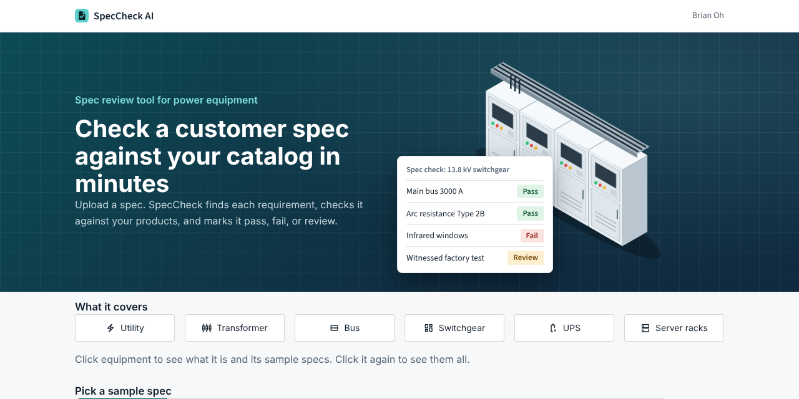
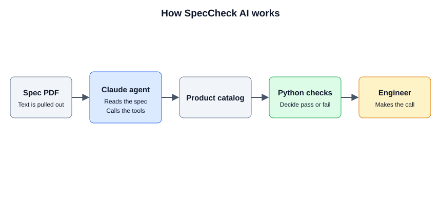

# SpecCheck AI: Spec Review Agent

**[Run SpecCheck AI online](https://spec-review-agent-5megvoy4huyip7c2tmz7fg.streamlit.app/)**

An AI agent that does the first pass on equipment spec reviews.

A customer spec can run many pages, and someone has to check every requirement against the product line. I built SpecCheck AI to do that first pass. It pulls out each requirement, checks it against a catalog, ranks the products, and flags what an engineer needs to look at.

SpecCheck uses the Claude API to read uploaded specs and find requirements. Python rules check the products and decide Pass, Fail, or Review.



> All specs, products, and prices in this repo are made up for this demo. They are not real ratings or prices from any manufacturer, and this project is not connected to any company.

## What it does

1. Reads one or more spec PDFs, like a spec and its addenda. Later documents override earlier ones.
2. Uses Claude to pull out each requirement, along with a word-for-word quote from the spec.
3. Checks each requirement against the catalog with plain Python rules.
4. Marks each item as Pass, Fail, or Review.
5. Ranks the products and recommends one only if it meets every must-have item. Ties go to the lower price, and a budget in the spec is checked like any other requirement.
6. Writes a short summary and lists questions for the customer.
7. Estimates the material cost of the best match. Copper, aluminum, lead, and nickel use monthly global prices from FRED. Steel, electrical steel, lithium, and transformer oil use prices you enter. Charts show the last 12 months of prices and price indexes from FRED.
8. Exports the compliance table as a PDF.

## Product catalog

The tool checks specs against 86 real product lines from 30 companies, including Eaton, Siemens, ABB, Schneider Electric, GE Vernova, Mitsubishi Electric, Vertiv, Hitachi Energy, Toshiba, Huawei, Rittal, Legrand, Panduit, S&C Electric, and nVent. Ratings were copied from each maker's public web page on Nov 13, 2026, and each product links to its source. Anything a page doesn't state is left blank, so it shows as Review. An option a page doesn't mention is also Review, not Fail, because public pages often leave options out.

SpecCheck is designed for sales and solutions engineers who compare customer specs with their company's products. A company can connect its own product API or use a private catalog file. I use public product details in this demo to show how the tool works without exposing a company's private API or product data.

`data/catalog.json` is a fixed, made-up catalog used only by the tests, so their results don't change when public data changes.

This project is not affiliated with or endorsed by any manufacturer. Check the source page before quoting any rating.


## Use a company's own product data

SpecCheck can check specs against a company's real product list instead of public datasheets. It is off until you turn it on.

1. Open `speccheck/api_catalog.py` and edit `FIELD_MAP` and `TYPE_MAP` so their field and category names match SpecCheck's.
2. Add these settings to `.env` on your computer, or to Streamlit Secrets online. Never put the key in GitHub.
   ```
   PRODUCT_API_URL = "https://api.example.com/v1/products"
   PRODUCT_API_KEY = "their_key"
   PRODUCT_API_AUTH = "bearer"   # or a header name like "X-API-Key"
   ```
3. Restart the app. It loads their products and refreshes every hour. If their API is down, it falls back to public datasheets and says so.

To save a snapshot instead of loading live, run `python -m scripts.pull_from_api`. It writes `data/catalog_company.json`; then set `CATALOG_FILE = "data/catalog_company.json"`. Don't commit that file to a public repo.

Company data is treated as the full option list, so an option it doesn't list is a Fail, not a Review. Use the data only as that company's terms allow.

## How it works



I split the work so each part does what it is best at:

| Part | Job | Why |
|---|---|---|
| Claude | Read messy spec language and call tools | Specs are written in many different ways |
| Python | Convert units, decide pass or fail, rank products | These answers must be exact and repeatable |
| Engineer | Review the results and make the final call | A wrong answer can reach a customer |

### Guardrails

- **Python makes the decision.** Claude cannot change a pass, a fail, or the recommendation.
- **Quotes are checked.** If a quote is not in the spec, or the value is not in the quote, the item goes to Review.
- **Unknown items are not guessed.** Unknown units, unknown values, and items outside the rules go to Review.
- **Spec text is treated as data.** The prompt tells Claude not to follow instructions found inside a spec.
- **Must-have items come first.** A product with a failed must-have item is never recommended.

## Website

`docs/index.html` is a product page with the sample results built in. It works with GitHub Pages and needs no Python or API key. It shows sample results only. Live Claude reviews use the Python app.

To publish it, go to **Settings > Pages** in GitHub, choose **Deploy from a branch**, then select **main** and **/docs**.

## Public demo

The app can run on Streamlit Community Cloud. Add `ANTHROPIC_API_KEY` under **Settings > Secrets** there. The app reads Streamlit secrets directly. Visitors would use your API credits, so set a spending limit and add `APP_PASSWORD` and `DAILY_REVIEW_LIMIT` as secrets too. Without a secret, visitors can paste their own key for one visit instead.

## Test it

```bash
pytest                          # Tests that need no API key
python scripts/evaluate.py      # Checks the Python rules on 11 sample specs
python scripts/evaluate.py --live   # Scores Claude on the sample specs (uses API credits)
```

The tests cover the checks, the source quote guardrail, the agent's tool loop, the MCP server, and the web app. The agent tests use fake API replies, so they check my code and not Claude's reading.

| Measure | Result |
|---|---|
| Recommendations correct with hand-labeled requirements | 11 of 11 |
| Claude's extraction accuracy | Not measured yet |

The sample specs are short and clean. Real specs are harder, so these results do not predict real-world accuracy.

## Use it with MCP

`mcp_server.py` shares the catalog search and compliance checks as MCP tools, so other AI apps can use them.

```json
{
  "mcpServers": {
    "speccheck": {
      "command": "/full/path/to/spec-review-agent/.venv/bin/python",
      "args": ["/full/path/to/spec-review-agent/mcp_server.py"]
    }
  }
}
```

## Main files and data

These are the main files behind the app:

| File | What it does |
|---|---|
| `app.py` | Runs the app you open in Streamlit. |
| `speccheck/agent.py` | Uses the Claude API to read a spec and list its requirements. |
| `speccheck/checks.py` | Uses Python rules to compare requirements with products and mark Pass, Fail, or Review. |
| `speccheck/review.py` | Picks the best match and makes the review reports. |
| `speccheck/api_catalog.py` | Optional: gets products from a company's product API. |
| `data/catalog_public.json` | Product details from public manufacturer pages. The app can check products in this file. |
| `data/catalog.json` | Made-up product data used by tests. It keeps test results steady; it is not the public product list. |
| `data/samples/` | Made-up specs used for the app's sample mode. |
| `.env.example` | Shows example settings. Add your own API keys in `.env`, and keep it private. |

Claude reads uploaded specs through its API. A company product API is a separate, optional source for product data. More test files and app details are in the folders beside these files.

## Limits

- It covers utility service sections, transformers, cable bus, isolated phase bus, non-segregated bus, switchgear, UPS systems, and server racks only.
- It reads PDF text, so scanned PDFs do not work yet.
- The Python app accepts up to about 100,000 words per review. Longer specs use more API credits. The spec is cached so each step of a review rereads it at a lower price.
- It does not read drawings or images.
- It does not apply altitude or temperature derating. It only compares values to the catalog limits.
- When two products tie, it picks the one listed first in the catalog.

## Next steps

- Run live scoring on more realistic public specs.
- Add OCR for scanned PDFs.
- Let an engineer edit results in the app.
- Add more equipment types, such as generators and segregated bus.

## Built with

Python, Claude API, MCP, Streamlit, pandas, pypdf, Pydantic, and pytest.

## License

[MIT](LICENSE)
