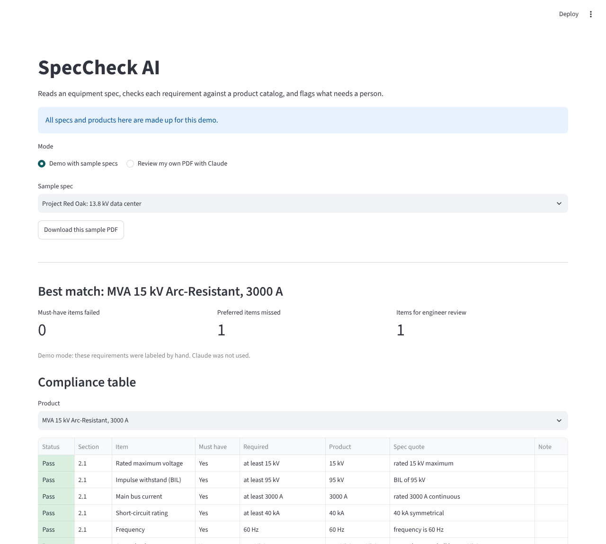
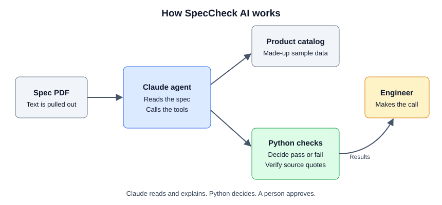

# SpecCheck AI: Spec Review Agent

An AI agent that does the first pass on equipment spec reviews.

A customer spec can run many pages, and someone has to check every requirement against the product line. I built SpecCheck AI to do that first pass. It pulls out each requirement, checks it against a catalog, ranks the products, and flags what an engineer needs to look at.



> All specs and products in this repo are made up for this demo. They are not real ratings from any manufacturer, and this project is not connected to any company.

## What it does

1. Reads a spec PDF.
2. Uses Claude to pull out each requirement, along with a word-for-word quote from the spec.
3. Checks each requirement against the catalog with plain Python rules.
4. Marks each item as Pass, Fail, or Review.
5. Ranks the products and recommends one only if it meets every must-have item.
6. Writes a short summary and lists questions for the customer.
7. Exports the compliance table as a CSV file.

## How it works



I split the work so each part does what it is best at:

| Part | Job | Why |
|---|---|---|
| Claude | Read messy spec language and call tools | Specs are written in many different ways |
| Python | Convert units, decide pass or fail, rank products | These answers must be exact and repeatable |
| Engineer | Review the results and make the final call | A wrong answer can reach a customer |

### Guardrails

- **Python makes the decision.** Claude cannot change a pass, a fail, or the recommendation.
- **Quotes are checked.** If a quote is not in the spec, or the value is not in the quote, the item goes to Review.
- **Unknown items are not guessed.** Unknown units, unknown values, and items outside the rules go to Review.
- **Spec text is treated as data.** The prompt tells Claude not to follow instructions found inside a spec.
- **Must-have items come first.** A product is recommended only when every must-have passes; a failed or unresolved must-have blocks the recommendation.
- **MCP checks verify quotes.** The checker compares each requirement quote with the supplied spec text before returning a pass or fail.

## Run it

You need Python 3.11 or newer.

```bash
git clone https://github.com/YOUR_USERNAME/spec-review-agent.git
cd spec-review-agent
python -m venv .venv
source .venv/bin/activate    # Windows: .venv\Scripts\activate
pip install -r requirements.txt
streamlit run app.py
```

Demo mode works without an API key. It uses requirements I labeled by hand, so it shows the Python checks and the interface without calling Claude.

To review your own PDF with Claude, copy `.env.example` to `.env` and add your [Claude API key](https://platform.claude.com/). This uses API credits, and the PDF text is sent to the Claude API.

## Website

`website/index.html` is a product page with the sample results built in. Open it in a browser to see it. It does not need Python or an API key. It uses a JavaScript copy of the checks, and it does not call Claude outside of Claude's artifact viewer.

## Test it

```bash
pytest                          # Tests that need no API key
python scripts/evaluate.py      # Checks the Python rules on 3 sample specs
python scripts/evaluate.py --live   # Scores Claude on the sample specs (uses API credits)
```

The tests cover the checks, the source quote guardrail, the agent's tool loop, the MCP server, and the web app. The agent tests use fake API replies, so they check my code and not Claude's reading.

| Measure | Result |
|---|---|
| Recommendations correct with hand-labeled requirements | 3 of 3 |
| Claude's extraction accuracy | Not measured yet |

The sample specs are short and clean. Real specs are harder, so these results do not predict real-world accuracy.

## Use it with MCP

`mcp_server.py` shares the catalog search and compliance checks as MCP tools, so other AI apps can use them.

```json
{
  "mcpServers": {
    "speccheck": {
      "command": "/full/path/to/spec-review-agent/.venv/bin/python",
      "args": ["/full/path/to/spec-review-agent/mcp_server.py"]
    }
  }
}
```

## Project layout

```text
app.py                  Web app
mcp_server.py           MCP server
speccheck/agent.py      Claude agent and tools
speccheck/checks.py     Pass or fail rules and quote checks
speccheck/review.py     Ranking and CSV export
speccheck/pdf.py        PDF reading
data/catalog.json       Made-up product catalog
data/samples/           Made-up specs and labels
scripts/evaluate.py     Scoring
tests/                  Automated tests
```

## Limits

- It covers low-voltage and medium-voltage switchgear only.
- It reads PDF text, so scanned PDFs do not work yet.
- It does not read drawings or images.
- It does not apply altitude or temperature derating. It only compares values to the catalog limits.
- When two products tie, it picks the one listed first in the catalog.

## Next steps

- Run live scoring on more realistic public specs.
- Add OCR for scanned PDFs.
- Let an engineer edit results in the app.
- Add more equipment types, such as transformers and UPS systems.

## Built with

Python, Claude API, MCP, Streamlit, pandas, pypdf, Pydantic, and pytest.

## License

[MIT](LICENSE)
